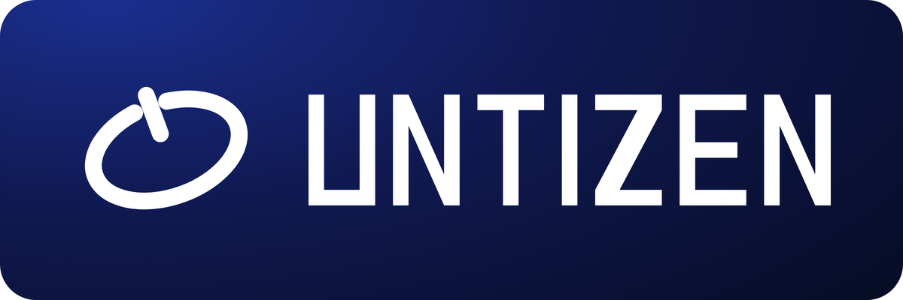
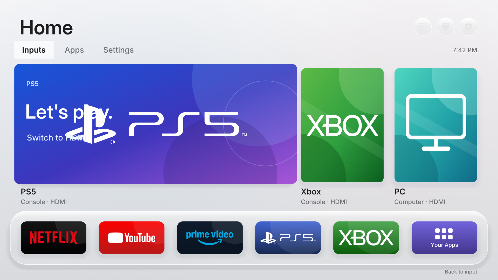
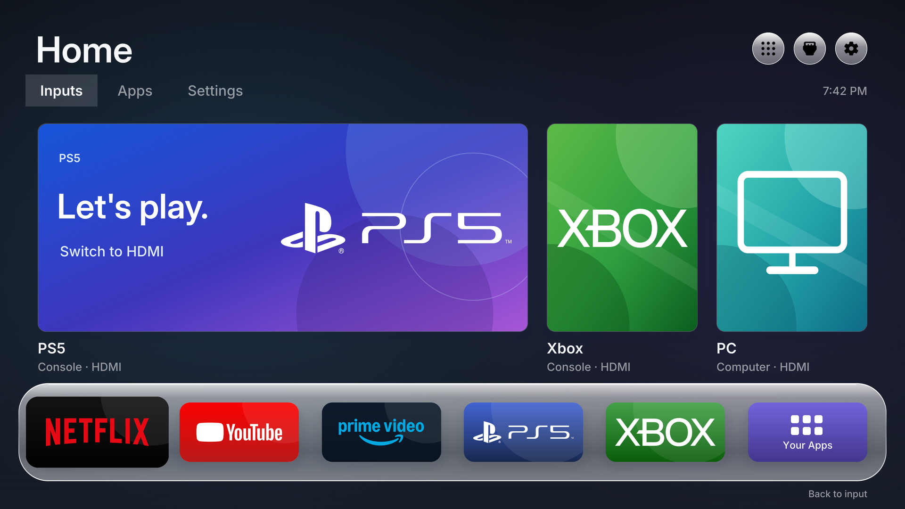
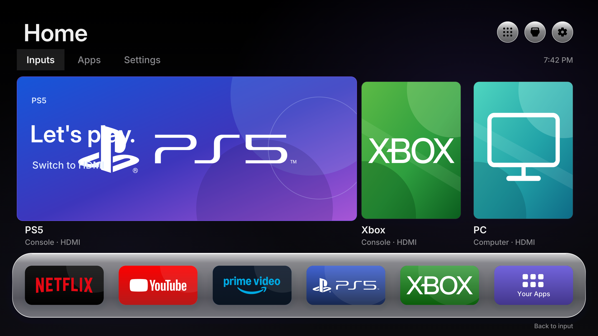
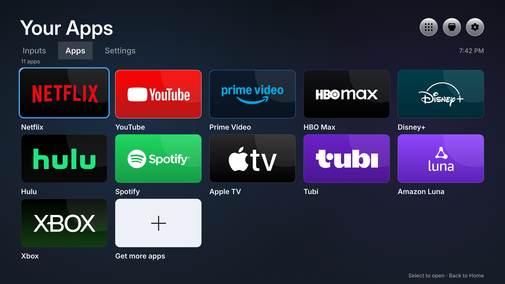
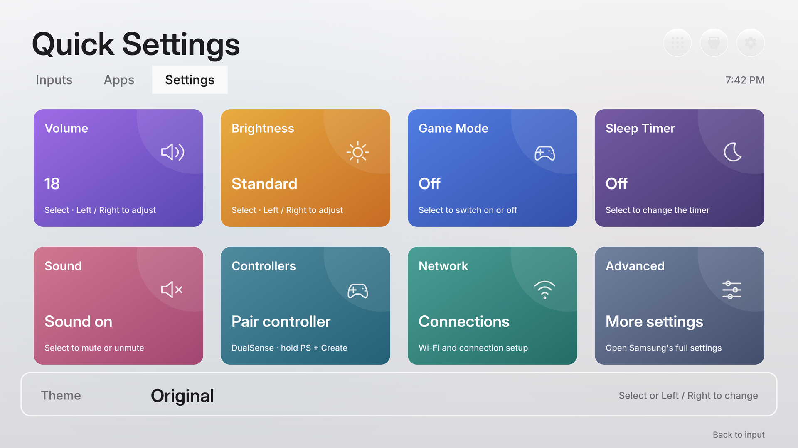
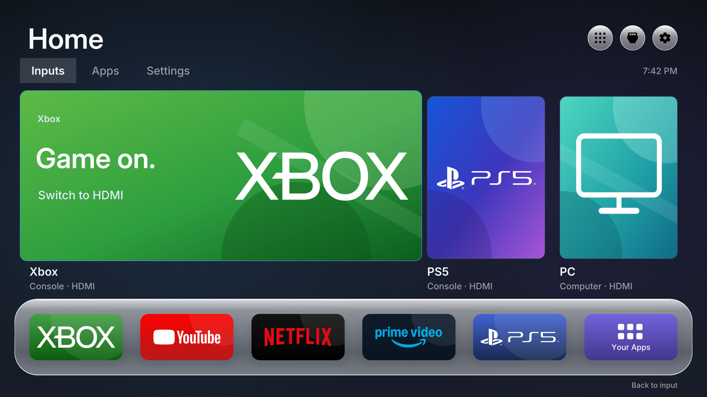
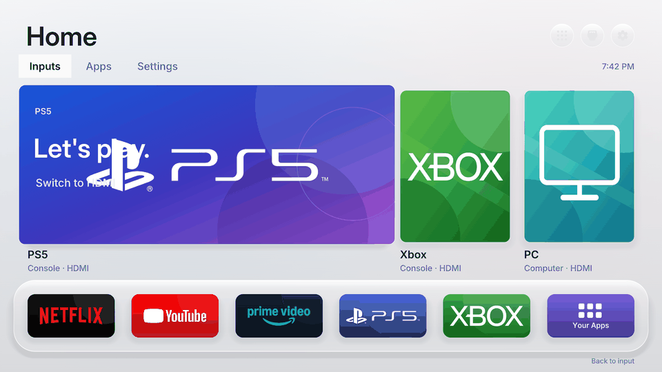

<div align="center">



**Make your Samsung Tizen TV quiet again.**

A native launcher, a reversible debloat planner and the temporary-root access
helper that makes both possible — without flashing anything.

[Docs](docs/01-inventory.md) · [Supported models](#supported-models) ·
[Quickstart](#quickstart) · [Contributing](CONTRIBUTING.md)

</div>

---

## What UnTizen does

Your TV boots into a shopping mall. UnTizen gives you back the display:

- **Quiet Home**, a native .NET/NUI launcher: HDMI sources, your real streaming
  apps as proper brand cards, quick settings for volume/brightness/sleep, three
  themes, and a shortcut to native Bluetooth controller pairing. No ad tiles,
  no "recommended for you" rows, no 20-second boot animation.
- **A home that follows the household**: the hero card is the input you used
  last, and the dock keeps the five most recent apps and inputs, newest first.
  The journal lives in `/var/tmp/untizen-recents.json` (a leftover
  `/var/tmp/quiet-home-recents.json` is still read).
- **A debloat planner** that disables registry flags for advertising, ACR,
  TV Plus, hotel/B2B signage and cloud-gaming helpers — one reviewed group at a
  time, with generated field-specific rollback SQL. Nothing is deleted.
- **An access helper** that obtains temporary authenticated root for one
  command, proves UID 0, cleans its own staging and leaves no daemon behind.

It is a working toolkit and case study for TVs you own — **not** a universal
installer, not a custom OS, and not a promise that every package is spyware.

## Demo

| Original | Glass | Dark |
|---|---|---|
|  |  |  |

| App library | Quick settings | Last used first |
|---|---|---|
|  |  |  |



The pictures are rendered offline from `demo/harness.html`, a static mirror of the
launcher layout that loads the same SVG/PNG assets the TV draws. Re-generate them
with `python3 demo/render.py` (headless Chrome + Pillow, no TV needed).
The `home-recents` shot feeds the harness the same journal the launcher writes
(`recents=` and `live=` query parameters) to show the reordered hero and dock.

## Supported models

Two panels have been exercised end to end. Everything else is a profile away.

| Model | Panel | Firmware | Runtime | Cleanup groups | Launcher |
|---|---|---|---|---|---|
| `UN75U8000FFXZA` | 2025 Crystal UHD 75" (U8000F) | `T-KSU2EFAKUC-0090-1300.9` | .NET 6.0.9 | 6 groups, 54 app IDs | Installed, Home/startup verified after restart |
| `QN55QN85CAPXPA` | 2023 Neo QLED 4K 55" (QN85C) | `T-PTMCUABC-0090-2220.4` | .NET 6.0.9 | 6 groups, 66 of 555 app IDs matched | Installed and daily-driven; 60 packages disabled in staged groups |

```sh
python3 tools/tv.py profiles    # no TV required
```

A matching brand, year or Tizen version is **not** compatibility. If your model
is not listed, start with the [inventory](docs/01-inventory.md), then add
`profiles/<model>-<firmware>.json`; the tools refuse to run against a model
they have no profile for, and they tell you which one to write.

## Quickstart

```sh
export SDB=/absolute/path/to/tizen-studio/tools/sdb
export TV_IP=192.0.2.100                       # your TV, your LAN
export TV_FIRMWARE='T-PTMCUABC-0090-2220.4'    # read it on the TV; never guessed
tv() { python3 tools/tv.py --host "$TV_IP" --firmware "$TV_FIRMWARE" "$@"; }

python3 tools/build.py payloads                # open-source access payloads
"$SDB" connect "$TV_IP:26101"
tv doctor                                      # preflight; no root yet
tv root-check                                  # temporary UID 0, cleaned up after

tv exec --script recipes/snapshot.sh --arg advertising-01
tv pull /opt/usr/share/untizen-backups/advertising-01/.pkgmgr_parser.db \
        .local/advertising-01-registry.db
python3 tools/plan_cleanup.py \
  --profile profiles/qn55qn85capxpa-2220.4.json \
  --snapshot .local/advertising-01-registry.db \
  --groups advertising                         # prints what matched; no writes
```

Then review the plan, add `--output .local/plans/advertising-01`, keep the
generated `restore.sh` on the TV, and apply one group at a time. The launcher
is a separate phase: build it, install it, verify it by hand, and only then
assign Home/startup.

1. [Inventory and compatibility](docs/01-inventory.md)
2. [Developer Mode and temporary root](docs/02-access.md)
3. [Snapshots and reversible cleanup](docs/03-cleanup.md)
4. [Build, install and assign the launcher](docs/04-launcher.md)
5. [Pair a DualSense over the TV's Bluetooth](docs/05-controller.md)
6. [Customize apps and artwork](docs/06-artwork.md)
7. [Slow streaming apps, without overclaiming](docs/07-performance.md)
8. [What the privacy work did and did not prove](docs/08-privacy.md)
9. [Restore the stock experience](docs/09-recovery.md)

## What is here

| Component | What it does |
|---|---|
| [Quiet Home source](launcher/src/Home.cs) | Native .NET/NUI home: HDMI cards, app library, quick settings, three themes |
| [App catalog](launcher/assets/apps.json) | Netflix, YouTube, Prime Video, HBO Max, Disney+, Hulu, Spotify, Apple TV, Tubi, Luna and Xbox — real brand art, pure SVG paths |
| [Cleanup catalog](data/cleanup-groups.json) | Model-agnostic bloat groups as `app_id` globs, plus the `keep_active` invariants no group may match |
| [Profiles](profiles) | Per-device facts: model, firmware, kernel, runtime, registry, launcher container, selected groups and overrides |
| [Cleanup planner](tools/plan_cleanup.py) | Resolves the catalog against *your* snapshot and emits guarded apply/restore SQL |
| [Access helper](tools/tv.py) | Profile-resolving SDB preflight, read-only `inventory`, temporary authenticated root, bounded transfers |
| [Device notes](docs/devices/README.md) | One-session inventories; not a substitute for an end-to-end profile |
| [Showcase](SHOWCASE.md) | Ports, restyles and other-OS work that stay out of this tree |
| [Recipes](recipes) | Inventory, snapshot, status, stop-marker, launcher, settings-bridge and restoration scripts |
| [Artwork tools](docs/06-artwork.md) | Vector/high-resolution sources, optional local downloads, retained image views |

## How the debloat stays safe

- Groups are **globs**, not device lists. The planner matches them against the
  app IDs in your own read-only snapshot, so it can only ever target something
  installed on your TV.
- `keep_active` invariants are checked before any plan is written: the
  Widevine/PlayReady DRM stack, the Cobalt engine behind YouTube, the stock
  home/settings shell, the broadcast system manager and the container the
  launcher lives in. A group that matches one of them is an error, not a
  warning.
- Only three registry fields change (`app_disable`, `app_onboot`,
  `app_autorestart`), inside one `BEGIN IMMEDIATE` transaction with a guard row
  per app. Drift aborts the transaction instead of overwriting it.
- Every plan ships with its exact inverse, generated from the same snapshot.
  `recovery.json` is first-wins. `tv drift` compares a later snapshot to that
  plan without needing a TV.
- Packages are never deleted, no partition is touched, no firmware is flashed,
  `/etc/passwd` and Samsung's SDB key stay as they are, and root is temporary
  per command.

## Give this repository to your coding agent

Clone it, open it in Cursor, Claude Code, Codex or Gemini CLI, and paste
[`PROMPT.md`](PROMPT.md). Fill in the model, firmware and TV IP from About
This TV and the network settings — never guess the firmware. Agents also
read [AGENTS.md](AGENTS.md): cleaning a TV follows the prompt and must not
edit the repo; changing profiles, the catalog or the launcher is a separate
job.

## Development

Host tools are Python 3.12+ and standard library only; raster artwork
conversion optionally uses Pillow. Source builds use the .NET 6 SDK to match
the tested TVs, and should be isolated from unrelated projects. Install
Samsung's SDB separately — it is not redistributed here.

```sh
python3 -m unittest discover -s tests -v
python3 tools/build.py payloads
# after obtaining the four private Tizen reference assemblies:
python3 tools/build.py launcher --framework .local/tv-framework
python3 tools/build.py package      # deterministic .local/package.tar.gz
```

GitHub Actions runs the offline tests: profile and catalog schemas, the
invariants, deterministic plan generation, app-catalog assets and packaging.
The NUI launcher build needs Samsung reference assemblies and is deliberately
not built in CI from redistributed SDK files.

## Credits and license

UnTizen is a fork and generalization of
[quiet-tizen](https://github.com/jss8649/quiet-tizen) (MIT), whose launcher
design adapts [Free My TV](https://github.com/simbasjungles/free-my-tv) (MIT)
and whose access route is a pinned subset of
[samsung-tv-root](https://github.com/chris-ritsen/samsung-tv-root) (Unlicense).
Bundled fonts are Inter derivatives under the SIL Open Font License. See
[NOTICE.md](NOTICE.md), [licenses/](licenses) and
[provenance](docs/provenance.md) for exact commits and local changes.

Project code is MIT-licensed. No Samsung firmware, stock app binary, SDK
reference assembly or private TV backup is redistributed. `launcher/assets/`
does ship vector brand marks for the streaming services and consoles the
launcher can start; they identify those services on a TV you own, every
trademark stays with its owner, and `tools/fetch_artwork.py` plus
`launcher/assets/apps.local.json` let you swap or drop any of them. This
project is not affiliated with Samsung, Sony, Nintendo, Microsoft, Amazon or
any streaming service.
